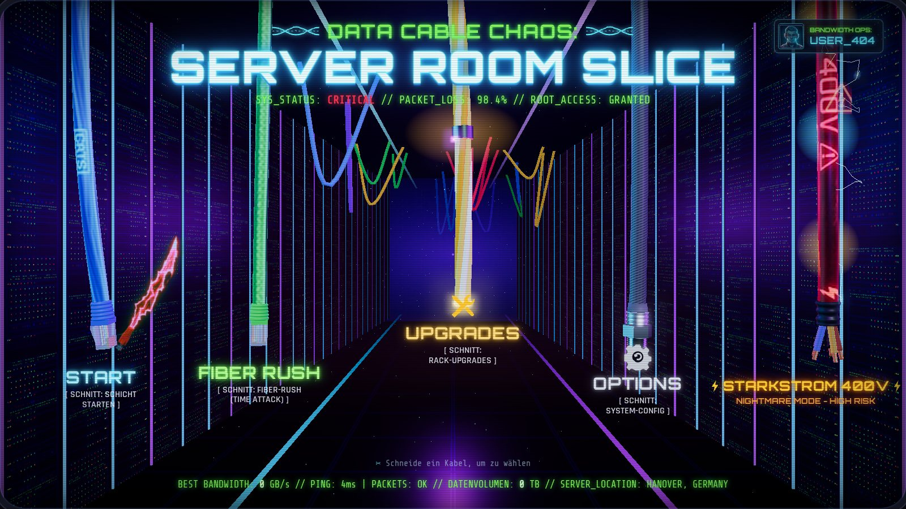
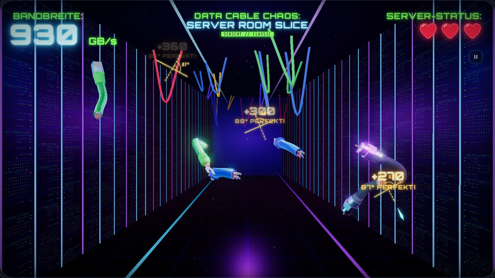
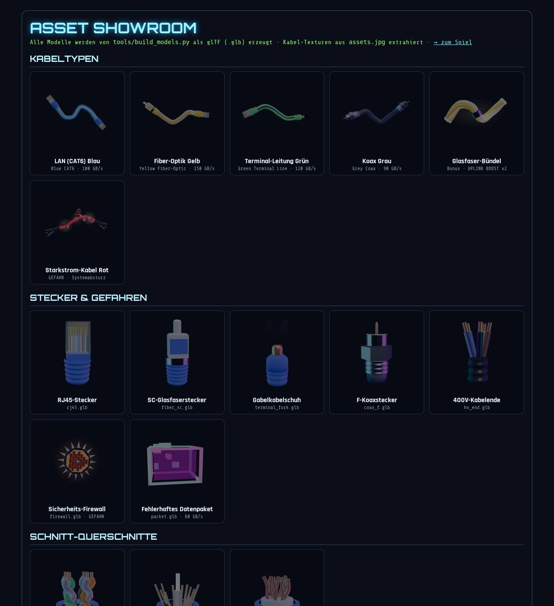
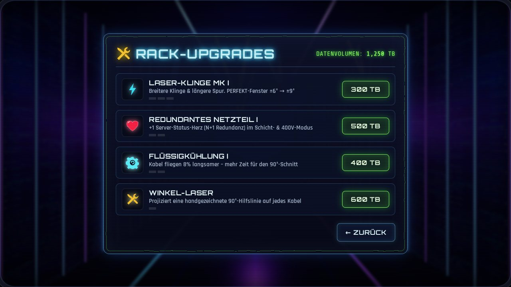

# DATA CABLE CHAOS: SERVER ROOM SLICE

**Kabelsalat & IT-Notfall** – Serverraum-Panik im Arcade-Stil. Du bist der Techniker im absoluten Notbetrieb:
lose Kabelstränge, defekte Glasfaserleitungen, fehlerhafte Datenpakete und Netzwerk-Stecker fliegen durch den
Serverraum – und du kappst sie mit deiner Laser-Klinge. Ein Fruit-Ninja-artiges Web-Game in 3D (Three.js).

| Menü | Gameplay |
| --- | --- |
|  |  |
|  |  |

Design-Referenzen: [`design/reference/`](design/reference) (Gameplay, Menü, Asset-Sheet).

## Spielen

Das Spiel ist eine statische Web-App ohne Build-Schritt. Wegen der ES-Module muss es über einen Webserver laufen:

```bash
python3 -m http.server 8000
# → http://localhost:8000          (Spiel)
# → http://localhost:8000/models.html  (3D-Asset-Showroom)
```

Läuft auf Desktop (Maus) und Mobile (Touch). Alles ist lokal eingebunden (Three.js, Fonts, Modelle), es werden
keine externen Ressourcen geladen.

### Steuerung

| Aktion | Eingabe |
| --- | --- |
| Schneiden | Maus gedrückt halten & ziehen / mit dem Finger wischen |
| Menü wählen | Das hängende Kabel durchschneiden (oder auf das Label klicken) |
| Pause | `Esc` / `P` / Pause-Button |

## Spielmechanik

* **Winkel-Scoring:** Die Punkte („Bandbreite“ in GB/s) hängen vom Schnittwinkel zur Kabelachse ab.
  | Winkel | Bewertung | Multiplikator |
  | --- | --- | --- |
  | 90° ± 6° (mit Upgrades bis ± 12°) | **PERFEKT!** | ×3 |
  | ≥ 70° | SAUBERER SCHNITT | ×2 |
  | ≥ 45° | OK | ×1 |
  | < 45° | SCHRÄG | ×0,5 |
* **Kabelende kappen (Strippen):** Schnitte nahe an einem Stecker geben ×1,5.
* **Kabelsalat-Combo:** 3+ Schnitte in einem Wisch geben einen Kettenbonus.
* Nach jedem Schnitt zeigt eine **handgezeichnete Winkelskizze** („boiling lines“) den gemessenen Winkel.
* **Gefahren:** Das **Starkstromkabel 400V** (rot, glüht gelb/blau, knisternde Lichtbögen) und die rotierende,
  gezackte **Sicherheits-Firewall** lösen sofort einen **Systemabsturz** aus.
* **Server-Status:** Jedes Kabel, das unten herausfällt, kostet ein Herz (Paketverlust).
* **Glasfaser-Bündel** (Bonus): 8 Sekunden **UPLINK BOOST ×2**.

### Modi

| Modus | Beschreibung |
| --- | --- |
| **START** – Schicht | Klassisch: 3 Herzen, Gefahren = Absturz |
| **FIBER RUSH** | 60 s Time-Attack ohne Herzen; Gefahren kosten −5 s und −250 GB/s |
| **STARKSTROM 400V** | Nightmare: schneller, viel mehr Gefahren, doppelte Punkte |
| **UPGRADES** | Rack-Upgrades mit verdientem Datenvolumen (TB): Laser-Klinge, Redundantes Netzteil, Flüssigkühlung, Winkel-Laser |
| **OPTIONS** | Sound, Musik, Bloom, CRT-Scanlines, Screen-Shake, Winkel-Skizzen, Klingenfarbe, Operator-Name |

Rekorde, Datenvolumen, Upgrades und Optionen werden im `localStorage` gespeichert.

## Asset-Pipeline

Die drei Referenzbilder in [`design/reference/`](design/reference) sind die Design-Vorlage. Die Assets werden
per Python erzeugt bzw. direkt aus dem Asset-Sheet extrahiert:

```bash
pip install numpy pillow
python3 tools/extract_assets.py    # schneidet Texturen & Sprites aus assets.jpg / menu.jpg aus
python3 tools/build_models.py      # erzeugt alle 3D-Modelle als glTF 2.0 (.glb)
python3 tools/generate_textures.py # malt Rack-Fronten, LED-Maske, Bodenplatten, Koax-Geflecht
```

| Script | Ergebnis |
| --- | --- |
| `extract_assets.py` | Kabelmäntel (CAT6 blau, Fiber gelb, Terminal grün, 400V rot inkl. Aufdruck) aus dem **KABELTYPEN/GEFAHREN**-Sheet → nahtlos kachelbare Tube-Texturen; **Schnitt-Funken**, **Laser-Klinge**, Warnschild, Zahnrad, Schraubenschlüssel → Alpha-Sprites (Hintergrund entfernt, Trennlinien per Inpainting entfernt); CRT-Monitor & Operator-Avatar |
| `build_models.py` | Eigener Mesh-Baukasten (Lathe, Sweep, Extrude mit Ear-Clipping, Box, Torus) + GLB-Writer in reinem numpy: RJ45-Stecker (transparentes Gehäuse, 8 Goldkontakte, Adern, Rastnase, geriffelte Tülle), SC-Glasfaserstecker mit leuchtender Ferrule, Gabelkabelschuh, F-Koaxstecker, 400V-Kabelende mit abisolierten Adern, Firewall-Schild mit Klingen, Datenpaket, sowie Schnitt-Querschnitte (Adernpaare, Aramid + Glaskern, Kupferlitze) |
| `generate_textures.py` | 19"-Rack-Front mit Servern, Switches, Patchpanels + Emissive-LED-Maske (im Shader animiert) |

Im Spiel werden die Kabel selbst als gebogene `TubeGeometry` mit den extrahierten Texturen gebaut, die GLB-Stecker
an die Enden gesetzt und beim Schnitt in zwei echte Teilstücke mit Querschnitt-Modell zerlegt.

## Projektstruktur

```
index.html          Spiel (HUD, Menü, Panels, handgezeichnete SVG-Icons)
models.html         3D-Asset-Showroom
css/style.css       Neon-/CRT-Design
js/main.js          Boot, Game-Loop, State-Machine
js/world.js         Renderer, Bloom, 3D-Serverraum-Korridor
js/assets.js        Textur-/GLB-Loader
js/cables.js        Kabel, Gefahren, Props, Schnitt-Geometrie & Hit-Tests
js/game.js          Spawning, Winkel-Scoring, Modi, Combos
js/menu.js          Hängende 3D-Menükabel
js/blade.js         Eingabe, Laser-Klingen-Spur, Winkelskizzen, Blitze
js/effects.js       Funken, Sprite-Bursts, Lichtstrahlen, Scherben
js/audio.js         Komplett synthetisierter Sound (WebAudio)
js/ui.js            HUD, Popups, Shop, Optionen, Game-Over
tools/              Python-Asset-Pipeline
assets/             Generierte Modelle, Texturen, Fonts
vendor/three/       Three.js r170 (MIT)
```

## Lizenzen

* [Three.js](https://threejs.org) – MIT (`vendor/three/LICENSE`)
* Fonts Orbitron, Rajdhani, Share Tech Mono – SIL Open Font License (Google Fonts)
